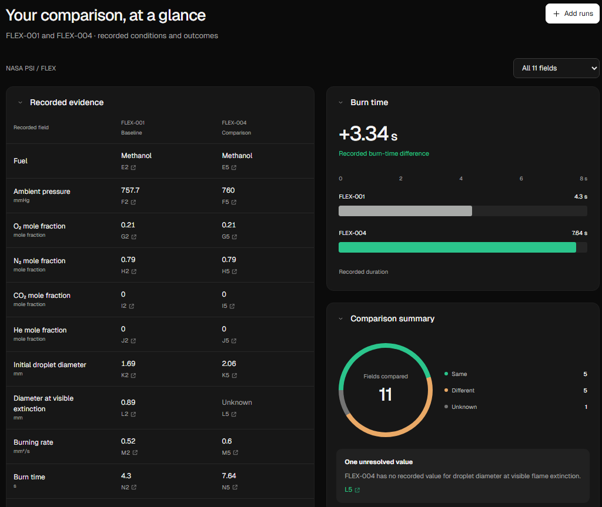
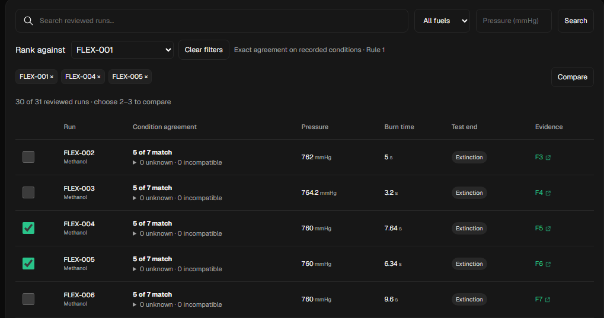
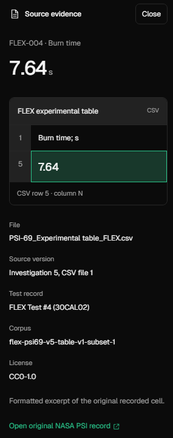
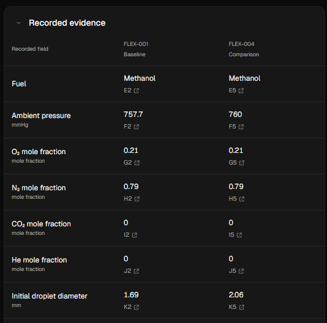
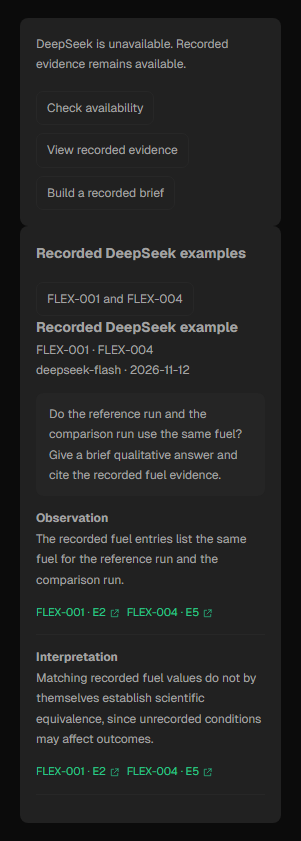

<h1 align="center">Fire Evidence Explorer</h1>

<p align="center">
  <strong>Compare microgravity flames and trace each finding to its source.</strong><br />
  NASA FLEX experiments, reviewable comparisons, and guided investigations in one browser workbench.
</p>

<p align="center">
  <a href="https://www.spaceappschallenge.org/2026/challenges/flame-in-freefall/">Flame in Freefall</a> · 2026 NASA Space Apps Challenge<br />
  Microgravity combustion research · By Desan Vasu
</p>

<p align="center">
  <a href="https://fire-evidence-explorer.vercel.app/"></a>
  <a href="https://github.com/desanv01/fire-evidence-explorer-spaceapps-2026/releases/download/space-apps-2026/Fire-Evidence-Explorer-Demo.mp4"></a>
  
  <a href="https://github.com/desanv01/fire-evidence-explorer-spaceapps-2026/actions/workflows/ci.yml"></a>
</p>

<p align="center">
  <a href="#features">Features</a> ·
  <a href="#demo">Demo</a> ·
  <a href="https://fire-evidence-explorer.vercel.app/">Open workbench</a> ·
  <a href="#get-started">Get started</a> ·
  <a href="#deepseek--bounded-execution">DeepSeek &amp; execution</a> ·
  <a href="#documentation">Documentation</a>
</p>

<p align="center">
  <a href="https://fire-evidence-explorer.vercel.app/?run=FLEX-001&amp;run=FLEX-004"></a>
  <br /><sub>Actual workbench capture · FLEX-001 and FLEX-004 · NASA PSI-69.</sub>
</p>

## Why Fire Evidence Explorer

Comparing microgravity combustion experiments means finding runs with relevant conditions, understanding missing measurements, and tracing each value to the original record. Fire Evidence Explorer brings those steps into one workbench so another person can inspect the same evidence.

**Current scope:** 31 reviewed NASA Flame Extinguishment Experiment runs, descriptive comparisons, and optional evidence-grounded DeepSeek assistance. [Dataset and selection notes](data/README.md)

## Features

<table>
<tr>
<td width="50%" valign="top">

### Find comparable runs

Search the collection and rank candidates by agreement in recorded conditions.

</td>
<td width="50%" valign="top">

### Compare conditions and outcomes

Compare two or three runs in source units, with gas composition and unknown values visible.

</td>
</tr>
<tr>
<td width="50%" valign="top">

### Trace exact source cells

Inspect the original NASA CSV row, column, and value behind a measurement.

</td>
<td width="50%" valign="top">

### Plot measurements

Choose axes in Visual Evidence Lab and see how many runs were omitted for missing values.

</td>
</tr>
<tr>
<td width="50%" valign="top">

### Keep an investigation notebook

Open a prepared investigation or pin evidence. Save on your device, import or export JSON, and print a report.

</td>
<td width="50%" valign="top">

### Review suggestions and export

Inspect optional DeepSeek explanations and confirm action proposals before applying them. Download briefs as JSON, CSV, or printable HTML.

</td>
</tr>
</table>

## Demo

**[Watch the narrated 29.8-second demo](https://github.com/desanv01/fire-evidence-explorer-spaceapps-2026/releases/download/space-apps-2026/Fire-Evidence-Explorer-Demo.mp4)** · [Submitted project](https://www.spaceappschallenge.org/2026/find-a-team/fire-evidence-explorer/?tab=project) · [Outline and four-minute presentation](https://github.com/desanv01/fire-evidence-explorer-spaceapps-2026/releases/tag/space-apps-2026)

1. Open the [FLEX-001 and FLEX-004 comparison](https://fire-evidence-explorer.vercel.app/?run=FLEX-001&run=FLEX-004).
2. Compare conditions and find the **+3.34 s** burn-time difference.
3. Open **row 5, column N** to verify FLEX-004's **7.64 s** value.
4. In **Notebook**, open a prepared investigation and export JSON or print a report.
5. Open the recorded same-fuel assistant example and follow its NASA source links.

<table>
<tr>
<td width="50%" valign="top">
  <a href="docs/assets/demo/rank.png"></a>
  <p><strong>Find a comparison.</strong> Rank candidates against a reference run.</p>
</td>
<td width="50%" valign="top">
  <a href="docs/assets/demo/source.png"></a>
  <p><strong>Check the source.</strong> Open row 5, column N in the FLEX table.</p>
</td>
</tr>
<tr>
<td width="50%" valign="top">
  <a href="docs/assets/demo/conditions.png"></a>
  <p><strong>Inspect the conditions.</strong> Review what was recorded for each run.</p>
</td>
<td width="50%" valign="top">
  <a href="docs/assets/demo/recorded-answer.png"></a>
  <p><strong>Follow a cited explanation.</strong> Inspect the recorded answer and its NASA citations.</p>
</td>
</tr>
</table>

[Capture provenance and attribution](docs/assets/demo/README.md)

## Get started

Open the [hosted workbench](https://fire-evidence-explorer.vercel.app/) for search, comparisons, source inspection, plots, notebooks, and recorded examples. These paths require no API key.

For local development, install **Node.js 24** and npm.

```sh
git clone https://github.com/desanv01/fire-evidence-explorer-spaceapps-2026.git
cd fire-evidence-explorer-spaceapps-2026
npm ci
npm run dev
```

Open `http://localhost:3000/`. Check `/api/health` for service status and `/api/evidence` for dataset metadata. Run `npm run typecheck`, `npm test`, and `npm run build` to verify the build. [Browser and API quickstart](docs/api-quickstart.md)

## DeepSeek & bounded execution

DeepSeek is optional and disabled in the default local setup. Hosted requests use a shared attempt limit. **Plan with AI** sends one bounded request for a plot, comparison context, or comparator search. Apply a proposal only after review. Opening a proposal or its sources uses zero additional model calls. [Configuration guide](docs/api-quickstart.md#optional-deepseek-configuration)

Signed evidence briefs bind a validated answer to the selected question and ordered runs. Manual actions, deterministic exports, recorded examples, and prepared investigations work without a live model request. [Chat and exports](docs/api-quickstart.md#chat-requests-and-exports)

## Recorded results

| Check | Observed result |
| --- | --- |
| Dataset coverage | 31 reviewed tests, FLEX-001 through FLEX-031 |
| Burn-time comparison | FLEX-001 records 4.30 s and FLEX-004 records 7.64 s under different conditions |
| Source lookup | FLEX-004 burn time resolves to row 5, column N. Its visible extinction diameter is unreported. |
| Prepared notebooks | Burn time, a missing burning rate, and visible flame extinction |
| Recorded model example | A saved same-fuel answer cites the two NASA methanol cells |

## Built with

| Layer | Tools |
| --- | --- |
| Workbench and API | TypeScript, Next.js, React, Zod |
| Hosting and optional model | Vercel, DeepSeek Flash, Upstash Redis |
| Data | NASA Physical Sciences Informatics, FLEX Experimental Table CSV |
| Demo | HyperFrames, GSAP, Microsoft Zira synthetic English narration |

## Architecture

```text
NASA PSI-69 CSV → Reviewed FLEX data and source manifest
                             ↓
              Search · Ranking · Comparison · Plots
                             ↓
           Source inspector · Notebook · Evidence brief
                             ↕
            Optional DeepSeek via server-side routes
```

The workbench computes comparisons from bundled records and passes a bounded evidence packet to the optional assistant. Explicit notebook saves use browser storage. Exports carry the dataset version and source locations. [Shared contracts](docs/upgrade-contracts.md)

## Scope and contributions

The app retains NASA's reported units, including pressure in mmHg and oxygen as a mole fraction. Comparisons describe recorded differences in the subset. They cannot establish causation or scientific equivalence.

For corrections, include the run ID, field, expected value, and original source cell.

## Documentation

| Guide | Covers |
| --- | --- |
| [Quickstart and API](docs/api-quickstart.md) | Requests, hosted setup, signed exports, and verification |
| [Guided investigations](docs/upgrade-investigations.md) | Prepared notebooks, reproducible comparisons, and exports |
| [FLEX dataset](data/README.md) · [Manifest](data/flex.sources.json) | Versions, checksums, row selection, and transformations |
| [Data contracts](docs/upgrade-contracts.md) | Plot, comparison, notebook, and assistant schemas |
| [Submission materials](https://github.com/desanv01/fire-evidence-explorer-spaceapps-2026/releases/tag/space-apps-2026) | Demo, outline, and supplementary presentation |

## Feedback

Report reproducible issues with the workbench, citations, and exports through [GitHub Issues](https://github.com/desanv01/fire-evidence-explorer-spaceapps-2026/issues).

## License and attribution

NASA's FLEX Experimental Table CSV is licensed **CC0-1.0**. NASA/TP-2015-216046, Table IX and Appendix A.1, supports field interpretation. The Geist font includes its [SIL Open Font License notice](public/fonts/geist-OFL.txt). [NASA PSI-69](https://psi.nasa.gov/physci/repo/data/investigations/PSI-69) · [Dataset DOI](https://doi.org/10.60555/mbq8-0451) · [Technical report](https://ntrs.nasa.gov/citations/20150023456)

Codex and DeepSeek Harness assisted development, writing, design, and verification. DeepSeek Flash produced optional explanations and the labeled recorded example. The demo uses workbench captures, a visible AI disclosure, and synthetic English narration. [Media credits](docs/assets/demo/README.md)
